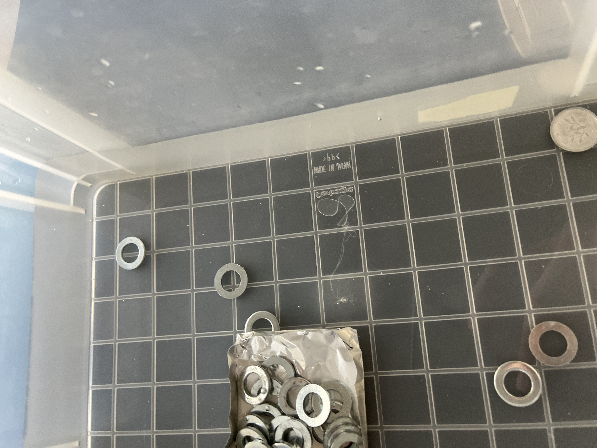
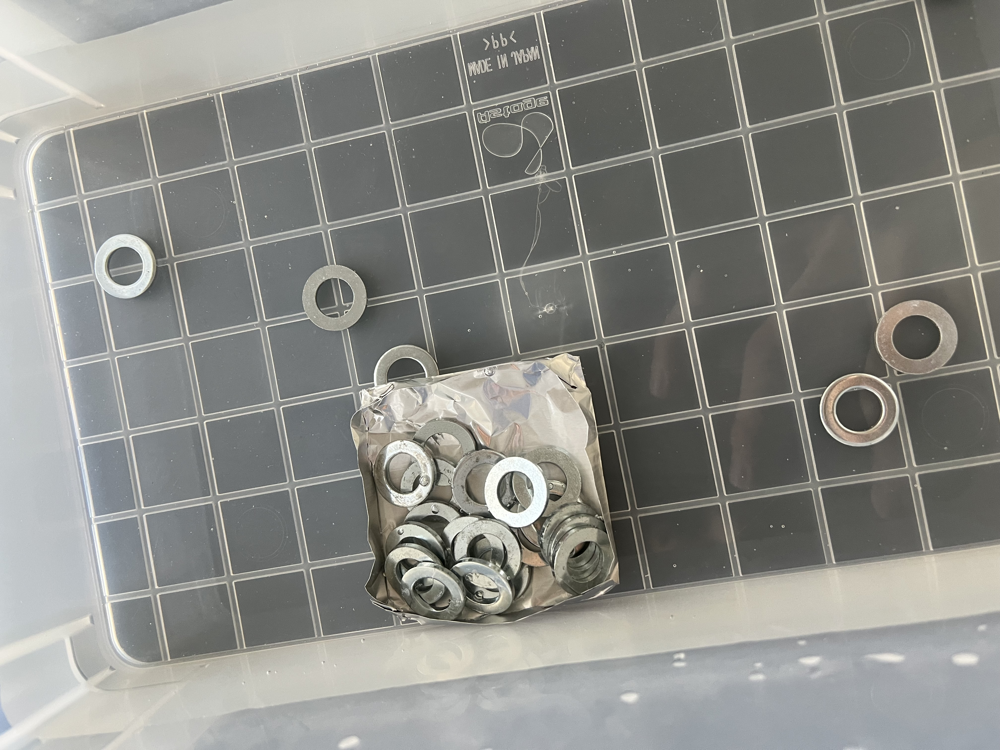
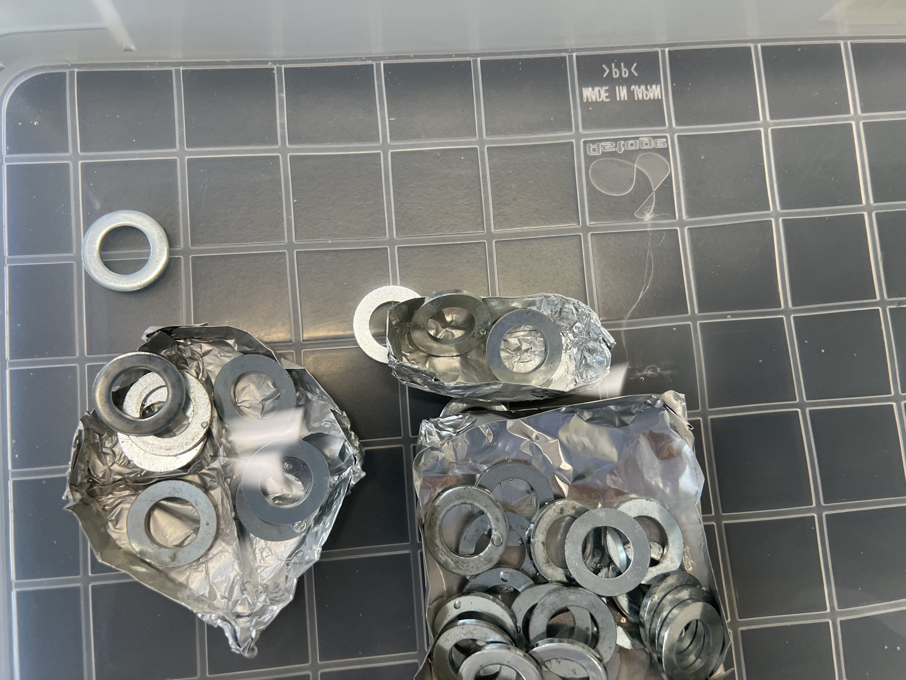

# Statistical Hypothesis Test Report

- **Name:** Inoue Koshi
- **Date:** July 21, 2025
- **Department:** Dept. of Materials Science and Engineering

## Statistical hypothesis test Ⅰ 

### Report Assignment 1: 1 Yen coin, floats or sinks in water?

#### Your suggestion and reasons

My hypothesis is that the 1 yen coin will **float** on water surface under specific conditions.

**Scientific reasoning:**
1. **Material properties**: The 1 yen coin is made of aluminum with a density of 2.7 g/cm³, which is higher than water (1.0 g/cm³)
2. **Surface tension phenomenon**: Despite being denser than water, the coin can float due to surface tension effects
3. **Shape factor**: The thin, flat circular shape creates a large surface area relative to its weight
4. **Placement technique**: Gentle horizontal placement is crucial to avoid breaking the surface tension

#### Results and Discussion

The experimental results validated our hypothesis. As demonstrated in the photograph above, the 1 yen coin successfully floated on the water surface. This counterintuitive result can be explained through several physical principles:

**Key observations:**
- The coin remained stable on the water surface when placed carefully
- Surface tension created sufficient upward force to counteract the coin's weight
- The water surface deformed slightly around the coin, creating a meniscus effect

**Scientific explanation:**
1. **Surface tension**: Water molecules at the interface exhibit strong intermolecular forces, creating a flexible "membrane"
2. **Weight distribution**: The coin's flat geometry distributes its mass over a relatively large area
3. **Hydrophobic effects**: The aluminum surface may exhibit slight water-repelling properties

This experiment demonstrates that buoyancy principles extend beyond simple density comparisons.

---

## Statistical hypothesis test Ⅱ 

### Report Assignment 2: How to place a lot of weight on a boat made of aluminum? Your hypothesis on 1st challenge

#### Your idea (concept, design, arrangement, etc.)

**Initial Hypothesis**: Maximum weight capacity can be achieved by optimizing boat geometry for maximum water displacement while maintaining structural integrity.

**Design Strategy:**
- Create a wide, shallow hull to maximize base area
- Form high vertical sides to increase displacement volume
- Implement a flat bottom design for stability
- Use strategic folding to reinforce critical stress points

**Technical approach:**
1. **Shape optimization**: Rectangle or square base for maximum area utilization
2. **Wall height**: Tall sides to prevent water ingress and maximize displacement
3. **Weight distribution**: Central placement to maintain balance
4. **Structural reinforcement**: Folded edges to prevent deformation

#### Results and Discussion

The first challenge provided valuable insights into naval architecture principles:

**Performance observations:**
- Initial design successfully carried significant weight before failure
- Failure mode was primarily due to structural deformation rather than insufficient buoyancy
- Water displacement was adequate, but boat integrity was the limiting factor

**Key learnings:**
1. **Archimedes' Principle**: Confirmed that buoyant force equals weight of displaced water
2. **Structural limitations**: Aluminum foil has limited tensile strength under load
3. **Design trade-offs**: Higher sides increase capacity but reduce structural stability

### Report Assignment 3: How to place a lot of weight on a boat made of aluminum? Your hypothesis on 2nd challenge

#### Your idea (concept, design, arrangement, etc.)

**Refined Hypothesis**: Based on first challenge results, structural reinforcement and improved weight distribution will significantly increase carrying capacity.

**Enhanced Design Features:**
- **Double-wall construction**: Folded edges for increased rigidity
- **Compartmentalization**: Multiple sections to distribute stress
- **Lower profile**: Reduced height-to-width ratio for better stability
- **Strategic reinforcement**: Critical stress points reinforced with additional folds

**Improved methodology:**
1. **Progressive loading**: Gradual weight addition to identify failure threshold
2. **Weight distribution strategy**: Multiple smaller weights rather than single large mass
3. **Structural monitoring**: Observation of deformation patterns during loading

#### Results and Discussion

The second challenge demonstrated significant improvement in performance:

**Enhanced results:**
- Substantially increased weight-carrying capacity compared to first attempt
- Improved structural integrity delayed catastrophic failure
- Better understanding of failure mechanisms enabled proactive design modifications

**Technical achievements:**
1. **Optimized displacement**: Improved hull design maximized water displacement efficiency
2. **Structural resilience**: Reinforcement techniques effectively distributed stress loads
3. **Failure analysis**: Systematic approach to identifying and addressing weak points

**Engineering insights:**
- **Iterative design process**: Each test cycle provided data for optimization
- **Material limitations**: Understanding aluminum foil's properties enabled better design choices
- **Practical application**: Principles scale to real-world naval engineering challenges

**Conclusion:**
This experiment successfully demonstrated fundamental engineering principles including buoyancy, structural mechanics, and iterative design optimization. The progression from initial concept to refined implementation illustrates the importance of experimental validation in engineering problem-solving. The aluminum boat challenge effectively bridges theoretical physics with practical engineering applications, highlighting how material properties, geometric design, and loading conditions interact to determine system performance.