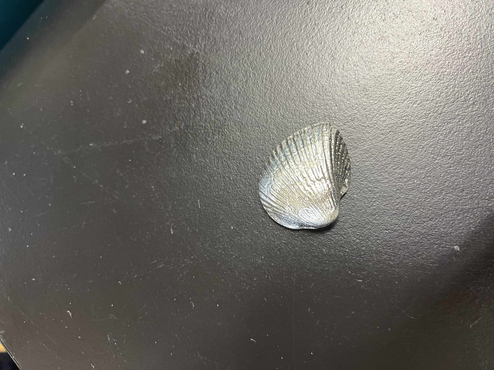

# Lab Report: Simple Casting Using Tin

- **Name:** Inoue Koshi
- **Date:** July 14, 2025
- **Department:** Dept. of Materials Science and Engineering

---

## 1. Objective

The objective of this experiment was to gain a practical understanding of the casting process by creating a small, seashell-shaped object using a tin-based alloy (pewter). This hands-on experience demonstrates the fundamental principles of the "Fukinagashi" sand casting method, a basic but effective technique for shaping metal.

---

## 2. Introduction

**Casting** is a fundamental manufacturing process where a liquid material, typically molten metal, is poured into a mold containing a hollow cavity of the desired shape, and then allowed to solidify. The solidified part is known as a **casting**. This method is highly effective for creating complex or intricate shapes that would be difficult or costly to produce by other methods, such as machining. The Great Buddha at Todai-ji temple is a world-renowned example of a large-scale casting.

In this experiment, we used **pewter**, an alloy primarily composed of tin (Sn), with smaller amounts of antimony (Sb) and copper (Cu). Pewter is ideal for simple casting demonstrations due to its low melting point, allowing it to be melted safely with basic equipment.

---

## 3. Materials and Methods

### 3.1. Materials and Equipment
- **Casting Material:** Pewter (91% Sn, 7% Sb, 2% Cu)
- **Mold:** Casting sand
- **Model:** A natural seashell
- **Equipment:**
    - Metal ring (to contain the sand mold)
    - Wooden boards (for support)
    - Tweezers
    - Water and a small brush
    - Melting pot and heat source for melting the pewter

### 3.2. Procedure
The "Fukinagashi" casting method was followed:

1.  **Model Placement:** The seashell model was placed on a flat wooden board, and the metal ring was placed around it.
2.  **Mold Creation:** Casting sand was carefully added into the ring, completely covering the model. The sand was packed down firmly by hand to ensure it captured all the details of the model's surface.
3.  **Mold Inversion:** A second wooden board was placed on top of the ring, and the entire assembly was carefully flipped over. The first board was then removed, exposing the seashell model embedded in the sand.
4.  **Model Removal:** The sand around the model was lightly moistened with a wet brush to help it hold its shape. The model was then carefully lifted out of the sand using tweezers, leaving a negative impression (the mold cavity).
5.  **Casting:** Molten pewter was carefully poured into the seashell-shaped cavity in the sand mold.
6.  **Cooling and Extraction:** The metal was allowed to cool and solidify completely. Once cooled, the finished tin casting was removed from the sand mold.
7.  **Finishing:** The casting was rinsed with water to remove any adhering sand particles.

---

## 4. Results

The experiment successfully produced a solid tin casting in the shape of the original seashell model. The final product replicated the fine ridges and overall form of the seashell, demonstrating the effectiveness of the sand casting method. The surface of the casting has the characteristic texture of a sand-cast object.

***Figure:*** *Additional view of the casting process or results.*

---

## 5. Discussion

### 5.1. Impressions of the Casting Experience
This experiment provided valuable hands-on insight into the casting process. The transformation of molten, liquid metal into a solid, detailed object was fascinating to observe. The process, while simple, required careful attention to detail, especially when packing the sand and removing the model to avoid damaging the mold cavity. The final product's texture directly reflects the sand used, providing a tangible connection between the process and the result. The low melting point of tin made the process accessible and safe, highlighting why it is an excellent material for introductory metalworking.

### 5.2. Additive Manufacturing vs. Casting
Additive manufacturing (AM), such as 3D printing, is a newer technology for producing metal parts and offers a different set of advantages and disadvantages compared to traditional casting.

**Advantages of Casting:**
-   Complex shapes can be made easily.
-   It is suitable for mass production of the same shape.

**Disadvantages of Casting:**
-   It is difficult to achieve accurate dimensions due to shrinkage during cooling.
-   The process is not well-suited for very thin, fine, or sharp-edged parts.
-   Internal pores, or "casting cavities," can form.
-   The surface finish is limited.
-   Special equipment is required.

**Advantages of Additive Manufacturing:**
-   **Complexity and Freedom of Design:** AM can create extremely complex, intricate, and lightweight structures (e.g., internal lattices) that are impossible to produce with casting.
-   **No Molds Required:** It eliminates the need for creating a mold, reducing lead time and costs for prototypes or one-off parts.
-   **Customization:** Each part can be easily customized without needing to modify tooling.
-   **Rapid Prototyping:** AM is significantly faster and cheaper for producing single prototypes.

**Disadvantages of Additive Manufacturing:**
-   **Mass Production Speed:** For large-scale production of the same part, casting is generally much faster and more cost-effective.
-   **Material Limitations:** The range of metals and alloys available for AM is still more limited than for casting.
-   **Post-Processing:** Many AM parts require significant post-processing steps, such as heat treatment, surface finishing, and removal of support structures, which adds time and cost.
-   **Cost:** The machinery and raw materials for metal AM can be very expensive.

In summary, casting remains superior for mass production of established designs, while additive manufacturing excels in creating highly complex, customized, or prototype parts.

---

## 6. Conclusion

This experiment successfully demonstrated the principles of sand casting using tin. A detailed seashell-shaped object was created, providing a practical understanding of mold-making, pouring, and solidification. The experience highlighted both the simplicity and the subtleties of the casting process and offered a valuable contrast to modern manufacturing techniques like additive manufacturing.

---
## 7. References
-   Kuroda, D. (2025). *Experience of simple casting using Tin*. [Internal instructional document]. Dept. of Materials Science and Engineering.